 

## 🎬 My work, in motion

Each card below is a small animated film of how the project actually works.

### 01 · Invoice OCR → structured JSON

Scanned invoices become searchable PDFs and clean JSON. PaddleOCR finds the text and boxes, and a fine-tuned **LayoutLMv3** labels the fields.
**97% SeqEval F1 · 94.5% OCR accuracy** → [`OCR--Text-to-JSON`](https://github.com/ro-hit-10/OCR--Text-to-JSON)

### 02 · AI customer-support agent @ PharmEasy

An LLM router reads the intent and calls the right tool across FAQs, orders, refunds, returns and ticketing. **76%** of queries are resolved with no human.
Related: [`Support-Ticket-Intelligence-Agentic-AI-System`](https://github.com/ro-hit-10/Support-Ticket-Intelligence-Agentic-AI-System)

### 03 · Prescription photo → cart @ PharmEasy

Zero-shot classification, OCR and NER pull drugs, doses and durations from a photo, then match them to catalog products and build the cart. **89%** extraction accuracy.

### 04 · Mental-health screening

RoBERTa models for domain classification (**80%**) and depression prediction (**95.6%**), plus T5 for contextual follow-up questions. Built as an aid for therapists, not a diagnosis. → [`AI_Based_Mental_Health_Screening`](https://github.com/ro-hit-10/AI_Based_Mental_Health_Screening)

### 05 · CodePulse AI - repository intelligence

n8n agentic workflows link GitHub, CI/CD and Semgrep to a vector database, so you can ask questions about a codebase and trace errors. **86%** on code Q&A.

### 06 · Merchant Growth AI

A LangGraph planner delegates to specialist agents and RAG, then returns a growth plan for a merchant. → [`Merchant-Growth-AI`](https://github.com/ro-hit-10/Merchant-Growth-AI)

### 07 · Credit-card fraud detection · IEEE ICOSEC 2024

SMOTE rebalances 30K+ transactions from 80:20 to 50:50. Four models are compared on F2-score, and XGBoost reaches **88% recall**.

 

## 📄 Publications

| Paper | Venue |
|---|---|
| Predictive maintenance for small-scale wind turbines using IoT + ML | SCIS 2025, Canberra · [DOI](https://doi.org/10.1007/978-3-032-22917-5_18) |
| AI-assisted mental-health screening | [DOI](https://doi.org/10.2991/978-94-6463-858-5_9) |
| Credit-card fraud detection with SMOTE + XGBoost | IEEE ICOSEC 2024 · [DOI](https://doi.org/10.1109/ICOSEC61587.2024.10722667) |
| IoT-based emergency vehicle alert system | IEEE ICIPCN 2024, Kathmandu University · [DOI](https://doi.org/10.1109/ICIPCN63822.2024.00119) |

## 🏆 Highlights

- 🎓 **Amazon Machine Learning Summer School 2026** - selected
- 🥇 **Top-10 finalist, UBS Hackathon 2025** - *Ed-Connect*, AI mentorship for underprivileged students
- 🛡️ Ran cybersecurity challenges for **1,500+ participants** at Hack Envasion CTF 2024
- 📚 Deep Learning Specialization (DeepLearning.AI)

## 🐍 Contribution snake

<picture>
  <source media="(prefers-color-scheme: dark)" srcset="https://raw.githubusercontent.com/ro-hit-10/ro-hit-10/output/snake-dark.svg">
  
</picture>

## 📫 Say hi

Open to ML / AI engineering roles and collaborations.
