**I build AI systems that read messy documents and talk to real customers.**
Data Science Intern @ **PharmEasy** · Final-year IT @ VIT Pune · 2× IEEE author

---

## ⚡ What I'm doing right now

- 🏥 **PharmEasy** - building an AI customer-support agent (intent routing + tool use, **76%** of queries resolved with no human) and an OCR prescription reader (**89%** extraction accuracy) that turns a photo into a cart.
- 🎓 **Amazon ML Summer School 2026** - selected.
- 🔭 Exploring: agentic workflows, RAG evaluation, layout-aware document models.

## 🧪 How a prescription becomes a cart

Simplified view of the type of pipeline I work on: classification, OCR and NER feeding product matching.

## 🚀 Selected work

| Project | What it does | Stack | Result |
|---|---|---|---|
| [**OCR → Text-to-JSON**](https://github.com/ro-hit-10/OCR--Text-to-JSON) | Turns scanned and digital invoices into searchable PDFs and structured CSV/JSON | PaddleOCR, PP-StructureV3, LayoutLMv3 | **97%** SeqEval F1 · **94.5%** OCR accuracy |
| [**Merchant Growth AI**](https://github.com/ro-hit-10/Merchant-Growth-AI) | AI growth assistant for merchants using multi-agent tool calling and RAG | FastAPI, LangGraph, Gemini | Multi-agent + RAG |
| [**Support Ticket Intelligence**](https://github.com/ro-hit-10/Support-Ticket-Intelligence-Agentic-AI-System) | Agentic system that triages and handles support tickets | Agentic AI | - |
| [**AI Mock Interview Coach**](https://github.com/ro-hit-10/ai-mock-interview-coach) | Practice interviews with AI feedback | Python | - |
| [**AI Mental Health Screening**](https://github.com/ro-hit-10/AI_Based_Mental_Health_Screening) | PHQ-9 based depression screening with generated follow-up questions | RoBERTa, T5 | **95.6%** depression-prediction accuracy |
| **CodePulse AI** | RAG over repositories + n8n agents wired to GitHub, CI/CD and Semgrep | n8n, Gemini Embeddings | **86%** on code Q&A and error tracing |

## 📄 Publications

- **Predictive maintenance for small-scale wind turbines using IoT + ML** - SCIS 2025, Canberra · [DOI](https://doi.org/10.1007/978-3-032-22917-5_18)
- **AI-assisted mental health screening** - [DOI](https://doi.org/10.2991/978-94-6463-858-5_9)
- **Credit-card fraud detection (SMOTE + XGBoost, 88% recall)** - ICOSEC 2024 · [DOI](https://doi.org/10.1109/ICOSEC61587.2024.10722667)
- **IoT-based emergency vehicle alert system** - ICIPCN 2024, Kathmandu University · [DOI](https://doi.org/10.1109/ICIPCN63822.2024.00119)

## 🏆 Highlights

- 🥇 **Top 10 finalist**, UBS Hackathon 2025 - *Ed-Connect*, AI mentorship for underprivileged students
- 🛡️ Ran cybersecurity challenges for **1,500+ participants** at Hack Envasion CTF 2024
- 🎓 Deep Learning Specialization (DeepLearning.AI)

## 🐍 Contribution snake

<picture>
  <source media="(prefers-color-scheme: dark)" srcset="https://raw.githubusercontent.com/ro-hit-10/ro-hit-10/output/snake-dark.svg">
  
</picture>

## 📫 Say hi

Open to ML / AI engineering roles and collaborations.
