



 

## 💼 My Work

### 01 · Invoice information extraction

Label Studio annotation, then a fine-tuned **LayoutLMv3** reads PaddleOCR output and returns structured JSON. **97% entity F1 · 94.5% OCR accuracy.**
→ [OCR--Text-to-JSON](https://github.com/ro-hit-10/OCR--Text-to-JSON)

### 02 · AI-assisted mental-health screening

PHQ-9 intake, RoBERTa domain and severity models, T5 follow-up questions and recommendations, with MongoDB behind a clinician dashboard. **95.6% depression-prediction accuracy.** Built as an aid, not a diagnosis.
→ [AI_Based_Mental_Health_Screening](https://github.com/ro-hit-10/AI_Based_Mental_Health_Screening)

### 03 · CodePulse AI

n8n workflows chunk and embed a repository into Supabase pgvector, run Semgrep and CI/CD checks in parallel, and power a RAG chatbot for code navigation. **86% on code reasoning and Q&A.**

### 04 · Vriddhi - Merchant Growth AI

A LangGraph orchestrator plans and delegates to specialist agents, with guardrails and human approval before any action runs.
**[▶ Live demo](https://vriddhi-merchant-growth-ai.vercel.app/)** · [Source](https://github.com/ro-hit-10/Merchant-Growth-AI)

### 05 · Credit-card fraud detection

SMOTE rebalances 30K+ transactions from 80:20 to 50:50. XGBoost wins on F2-score with **88% recall**. Published at IEEE ICOSEC 2024.

### 06 · FairHire - adaptive AI interview coach

An LLM-driven strategy agent decides whether to probe deeper, simplify or move on after every answer, then a coach agent writes the final report.
→ [ai-mock-interview-coach](https://github.com/ro-hit-10/ai-mock-interview-coach)

 

## 🧰 Tech Stack


 

## 🏆 Highlights


 

## 📄 Publications


- [IoT-based emergency vehicle alert system](https://doi.org/10.1109/ICIPCN63822.2024.00119) - IEEE ICIPCN 2024
- [Credit-card fraud detection](https://doi.org/10.1109/ICOSEC61587.2024.10722667) - IEEE ICOSEC 2024
- [Predictive maintenance for small-scale wind turbines](https://doi.org/10.1007/978-3-032-22917-5_18) - SCIS 2025
- [AI-assisted mental-health screening](https://doi.org/10.2991/978-94-6463-858-5_9) - Atlantis Press

 

## 🐍 Contribution snake

<picture>
  <source media="(prefers-color-scheme: dark)" srcset="https://raw.githubusercontent.com/ro-hit-10/ro-hit-10/output/snake-dark.svg">
  
</picture>

## 📫 Connect with me

